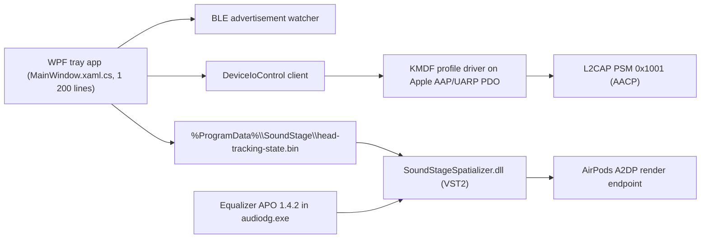

# SSAP3 architecture audit

Audit of the inherited SoundStage for AirPods code base (fork of
`capriqqw/soundstage-for-airpods`, audited at commit `114143c`), performed
before SSAP3 development started on branch `development/ssap3`.

File references in this document use the **original** paths. The rename map
to SSAP3 paths is at the end.

## 1. What the inherited system is

| Layer | Language | Runtime | Notes |
| --- | --- | --- | --- |
| Tray UI + orchestration | C# 12, WPF + WinForms `NotifyIcon` | .NET 8, `net8.0-windows10.0.19041.0` | Single window, all logic in code-behind |
| Protocol core | C# | .NET 8 | Packet factory and parsers, no I/O |
| Windows platform | C# + P/Invoke | WinRT BLE, `BluetoothApis.dll`, `cfgmgr32`, `DeviceIoControl` | |
| Kernel transport | C, KMDF 1.31 | Windows kernel | BRB-based L2CAP client, ~1 400 lines |
| DSP | C++20 | Inside `audiodg.exe` via Equalizer APO's VST2 host | Parametric binaural model |
| Installer | Inno Setup 6 + PowerShell 5.1 | Elevated | Two-phase, Test Mode based |
| CI | GitHub Actions | `windows-latest` | Builds app, smoke tests, spatializer, icons |

Baseline verification on 2026-11-13: `dotnet build` of the app (Release)
succeeded with 0 warnings, and `SoundStage.Core.SmokeTests` passed, using
.NET SDK 8.0.428. The C/C++ components were not built locally (no MSVC/WDK on
the development PC).

## 2. Answers to the required audit questions

1. **How does it talk to AirPods?** Two paths. Battery/in-ear/lid state comes
   from Apple BLE manufacturer advertisements
   (`WindowsBleAirPodsScanner.cs`). Control and motion go over AACP, an
   L2CAP channel on PSM `0x1001`, opened by the KMDF driver.
2. **Does it implement AAP?** Partially: handshake, feature flags,
   notification request, noise-control (`0x0D`), conversational awareness
   toggle (`0x28`), "owns connection" (`0x06`), head-tracking start/stop, and
   parsers for battery (`0x04`) and head-tracking frames (`0x17`).
   Packet bytes match LibrePods' public `docs/AAP Definitions.md` and
   `linux/airpods_packets.h`, with one discrepancy: LibrePods' doc and
   header disagree on the feature-flag byte (`FF` vs `D7`) and the
   notification-request bytes; the inherited code uses the header variant.
3. **How are Bluetooth connections established?** Windows pairs and owns the
   ACL link. The driver is installed on the BTHENUM PDO that Windows creates
   for the Apple AAP service UUID `74ec2172-0bad-4d01-8f77-997b2be0722a`
   (fallback: UARP `4715650b-…`), then submits `BRB_L2CA_OPEN_CHANNEL` to the
   remote device address from `IOCTL_INTERNAL_BTHENUM_GET_DEVINFO`.
4. **Is motion actually received?** Only when the driver is loaded. The app
   sends `0x06 owns-connection`, waits 350 ms, sends an "alternate" start
   packet, and falls back to the LibrePods start packet after 2 s
   (`MainWindow.xaml.cs:446-462, 576-589`). Upstream reports it working on
   AirPods 4 (ANC). **Not verified on AirPods Pro 3** (see
   `HARDWARE_COMPATIBILITY.md`).
5. **How are motion packets parsed?** `HeadTrackingFrameParser.cs` checks a
   12-byte prefix and a length > 60, reads three little-endian `int16`
   "orientation" values at offsets 43/45/47 and two acceleration values at
   51/53.
6. **Are quaternions decoded correctly?** **No quaternion exists.**
   LibrePods documents those fields only as opaque "orientation 1/2/3". The
   parser turns them into pitch/yaw with a heuristic
   (`pitch = (o2+o3)/2/32000*180`, `yaw = (o2-o3)/2/32000*180`). Roll is
   discarded. The field semantics are unverified reverse engineering.
7. **Is orientation timestamped?** No. Frames carry no timestamp and the app
   stamps only the output state with wall-clock time.
8. **How does head tracking reach the renderer?** The app smooths yaw/pitch
   with an adaptive one-pole filter in the UI class, then writes a 40-byte
   seqlock record into a memory-mapped file in `%ProgramData%`. The VST
   inside `audiodg.exe` maps it read-only every audio block.
9. **How is audio processed?** Equalizer APO is attached as SFX/MFX/EFX on
   every render endpoint whose name contains "AirPods", and runs the VST at
   post-mix. The VST renders two virtual speakers at ±38° with ITD, ILD,
   one-pole far-ear low-pass, eight early-reflection taps and a four-line
   FDN. **No HRTF data and no convolution are used.**
10. **WASAPI shared or exclusive?** Neither directly. Processing is an
    endpoint effect, so it applies to shared-mode streams. Exclusive-mode
    and ASIO streams bypass it.
11. **Does it install a kernel driver?** Yes, test-signed, KMDF.
12. **Why is the driver necessary?** Windows exposes no supported user-mode
    API for classic (BR/EDR) L2CAP connection-oriented channels. WinRT offers
    RFCOMM and GATT. Winsock `AF_BTH` supports RFCOMM only, so the inherited
    `WindowsL2CapAacpClient` probe is expected to fail (not yet run on this
    machine). AACP is L2CAP-only, so **every AAP feature needs a kernel
    profile driver**.
13. **Could user mode replace the driver?** Only for the BLE-advertisement
    features: battery, in-ear and lid. Listening-mode control, AACP battery,
    conversational awareness and head tracking cannot be reached from user
    mode on Windows today.
14. **Reconnection handling?** A 4 s `DispatcherTimer` polls the classic
    paired-device state, drops the driver session on change, and after a
    12 s throttle calls `BluetoothSetServiceState` off/on to recreate the AAP
    PDO. `ConnectionStateMachine.cs` exists but **is not used by the app**.
    There is no backoff, no sleep/resume hook, no motion-stall detection
    beyond a one-time 5 s message, and no protection against concurrent
    `StartMotionTrackingAsync` calls.
15. **Windows 11 support?** The managed app runs on Windows 11. The
    installer assumes it can switch Test Mode on, which Windows 11 blocks
    while Secure Boot is on.
16. **AirPods Pro 3 support?** Not specifically. The advertisement model
    table has no AirPods Pro 3 entry. The INF lists no Pro 3 product ID, but
    its `BTHENUM\{AAP UUID}` and `_GENERIC` fallback lines match the
    compatible IDs that Windows reports for the Pro 3 AAP PDO, so the driver
    would bind. Head-tracking and control behaviour on Pro 3 firmware is
    unverified.
17. **What prevents a normal installation?** The driver is test-signed. The
    installer needs Secure Boot off, `bcdedit /set testsigning on`, a
    BitLocker suspension, a reboot, and a second run.
18. **Security weaknesses?** Yes. Three are critical: a root-CA certificate
    is imported into LocalMachine\Root; a user-writable elevated uninstaller
    allows local privilege escalation; and Test Mode is required. See
    `SECURITY_AUDIT.md`.
19. **Unnecessary system modifications?** Test Mode, a BitLocker suspension,
    root and TrustedPublisher certificates, `DisableProtectedAudioDG=1`,
    ownership/ACL changes on MMDevices keys that are never restored,
    `BUILTIN\Users:Modify` on the whole ProgramData folder, an HKLM Run key
    for all users, and a desktop shortcut created in the elevated context.
20. **Does it leak data or talk to the network?** No network code exists in
    the app, driver or DSP: a search for HTTP/socket/DNS APIs found only XAML
    namespaces and installer metadata URLs. Diagnostic ZIPs are created only
    on demand and stay local, but they contain unredacted Bluetooth
    addresses and device names.

## 3. Subsystem classification

| Subsystem | Original location | Verdict | Reasoning |
| --- | --- | --- | --- |
| Tray UI | `src/SoundStage.App/MainWindow.xaml*` | **Improve** | Works and is visually finished, but transport, motion math, retry policy and UI share one class. It reports a listening-mode change as successful before the AirPods confirm it. It has no recenter and no motion-stall state. |
| Settings | `SoundStageUserSettings.cs` | **Improve** | No validation, no size limit, and it saves on every case-battery packet. |
| App log | `SoundStageAppLog.cs` | **Improve** | Unbounded growth, and full exception text includes device addresses. |
| Packet factory | `SoundStage.Core/AacpPacketFactory.cs` | **Keep / Improve** | Noise control, CA, owns-connection and handshake match LibrePods docs. Feature-flag and notification-request variants are **not yet verified** on Pro 3. |
| Motion parser | `HeadTrackingFrameParser.cs` | **Replace** | It hides calibration state in the parser, drops the first 10 frames, uses an unverified heuristic, carries no timestamps and does no range validation. |
| Battery parser | `AirPodsBatteryPacketParser.cs` | **Keep / Improve** | Matches LibrePods. It needs a timestamp and must keep "unknown" separate from "discharging". |
| Advertisement parser | `AirPodsAdvertisementParser.cs` | **Improve** | It has no Pro 3 model entry and accepts advertisements from any nearby AirPods. Its case-battery cache is keyed by a rotating private address. |
| RPA/crypto helpers | `BluetoothCryptography.cs` | **Keep** (not yet verified) | Spec-shaped AES `ah`. Nothing in the app supplies an IRK, so it is never exercised. |
| Connection state machine | `ConnectionStateMachine.cs` | **Replace** | Not used by the app. Its events do not model motion, stalls, sleep, or capability. |
| Audio profile advisor | `AudioProfileAdvisor.cs` | **Keep** | Small pure policy; used by diagnostics. |
| BLE scanner | `WindowsBleAirPodsScanner.cs` | **Improve** | Active/passive fallback is good. It does no filtering by RSSI or by paired model. |
| Paired-device finder | `WindowsRememberedAirPodsFinder.cs` | **Improve** | It matches on the substring "AirPods" in the friendly name, so renamed devices are missed and any device with that name is accepted. Should use the Apple VID/PID. |
| AAP service repair | `WindowsAirPodsServiceManager.cs` | **Improve** | Uses the supported `BluetoothSetServiceState`. A forced off/on toggle can disrupt audio, so it should only run on explicit user action and be throttled. |
| Driver client | `SoundStageDriverAacpClient.cs` | **Improve** | IOCTL layout is correct. Reads are synchronous polls with no timeout, and it binds to the first interface instance found, not the requested address. |
| L2CAP socket probe | `WindowsL2CapAacpClient.cs` | **Keep (diagnostic only)** | Documents that Winsock L2CAP is unavailable. Not yet verified on this machine. |
| Head-pose IPC writer | `HeadTrackingAudioStateWriter.cs` | **Replace** | v1 layout with no validation contract and wall-clock timestamps. It writes into a folder whose ACL is the LPE in S-02. |
| Windows Sonic control | `WindowsSpatialAudioController.cs` | **Improve** | Depends on the NirSoft binary, and it searches parent folders for that executable (S-10). |
| Diagnostics | `src/SoundStage.Diagnostics` | **Improve** | Read-only collection is good; needs redaction (S-13). |
| Transport probe | `src/SoundStage.TransportProbe` | **Keep** | Developer tool. |
| KMDF driver | `driver/SoundStageKmdf` | **Improve** (keep minimal design) | Genuinely required for AACP. It is narrow: no generic BRB pass-through and no parsing in the kernel. It needs session limits, timeouts, a fix for the reader-stop race, address binding, the Pro 3 hardware ID, and a new identity. It also needs **Microsoft production (attestation) signing**. |
| DSP | `audio/SoundStageSpatializer` | **Improve now, Replace later** | Fix the S-04 memory-safety bug and the mode-switch clicks now. Replace the parametric model with HRIR convolution and SOFA-derived data in a later milestone. |
| Equalizer APO integration | `installer/Install-SpatialAudioEngine.ps1` | **Improve (explicit opt-in)** | It is the only system-wide insertion point available without a signed audio driver. It requires `DisableProtectedAudioDG=1`, which Equalizer APO's own docs say disables the APO signature check, so it must be opt-in and exactly reversible. |
| SoundVolumeView | `third_party/SoundVolumeView` | **Not yet verified / Improve** | Unsigned third-party freeware binary committed to git, used only to switch Windows Sonic off. Add integrity pinning, then look at removing it. |
| Installer | `installer/*.ps1`, `SoundStage.iss` | **Replace** | Test Mode, root trust and user-writable elevated scripts. There is no manifest and no rollback. |
| Uninstaller | `installer/Uninstall-*.ps1` | **Replace** | Trusts user-writable state, never restores ACL/ownership changes, and is not idempotent around Test Mode. |
| CI | `.github/workflows/ci.yml` | **Improve** | No driver build, static analysis, dependency or secret scanning. Actions are **not enabled on the fork**: the GitHub API reports 0 workflow runs. |
| Brand assets | `assets/` | **Replace** | Rebrand to SSAP3. |
| Docs | `README.md`, `docs/*` | **Replace** | They document the Test Mode installation. |

## 4. Structural problems that drive the SSAP3 design

1. **One process does everything on the UI thread's dispatcher.** The motion
   loop polls the driver every 18 ms under a `SemaphoreSlim` that is shared
   with control commands, so a slow control command stalls motion.
2. **Motion math lives in the UI class.** It cannot be unit-tested and has no
   timestamping or interpolation.
3. **State is reported optimistically.** "AirPods mode changed" is shown once
   the IOCTL succeeds, but per LibrePods the AirPods echo
   `04 00 04 00 09 00 0D <mode> 00 00 00` once the change is applied, and the
   app never waits for that echo.
4. **The trust boundary between the unprivileged app and `audiodg.exe` is a
   file in a world-writable folder**, and the DSP does not validate floats.
5. **Installation weakens the platform** instead of degrading features.

## 5. SSAP3 target architecture (summary)

Full plan: `IMPLEMENTATION_ROADMAP.md`.

- **Driverless tier (works with Secure Boot, HVCI and Defender on):** tray
  app, BLE battery/in-ear/lid, spatial renderer with a fixed (not
  head-tracked) soundstage, diagnostics.
- **AAP tier:** needs the KMDF driver, signed through Microsoft attestation
  signing. When the driver is missing or unsigned, the app shows exactly
  which features are unavailable and why. It never prompts for Test Mode.
- **Development tier:** a separate, clearly labelled developer script for
  test-signed driver builds on a developer's own machine. It is never part of
  the production installer.
- Protocol, motion (quaternion + SLERP, timestamped, recenter, stale
  detection), connection supervision, and conversation detection move into
  `SSAP3.Core`, which has no I/O and full unit-test coverage.
- The DSP treats shared state as untrusted input (range and finite checks,
  versioned layout, monotonic timestamps).

## 6. Rename map

| Original | SSAP3 |
| --- | --- |
| `src/SoundStage.App` (`SoundStage.exe`) | `src/SSAP3.App` (`SSAP3.exe`) |
| `src/SoundStage.Core` | `src/SSAP3.Core` |
| `src/SoundStage.Platform.Windows` | `src/SSAP3.Platform.Windows` |
| `src/SoundStage.Diagnostics` | `src/SSAP3.Diagnostics` |
| `src/SoundStage.TransportProbe` | `src/SSAP3.TransportProbe` |
| `tests/SoundStage.Core.SmokeTests` | `tests/SSAP3.Core.Tests` |
| `driver/SoundStageKmdf` (`soundstage-airpods4-anc.sys`) | `driver/Ssap3Aap` (`ssap3aap.sys`) |
| `audio/SoundStageSpatializer` | `audio/Ssap3Spatializer` |
| `installer/SoundStage.iss` | `installer/SSAP3.iss` |
