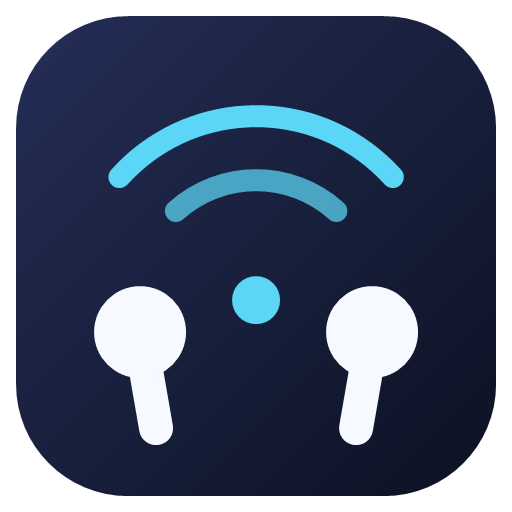

  

<h1 align="center">SSAP3</h1>

  <b>Spatial Sound for AirPods Pro 3</b>: a head-tracked, computer-anchored
  soundstage and AirPods controls for Windows 11.

  
  
  

> [!IMPORTANT]
> SSAP3 is under active development on the `development/ssap3` branch and has
> **not been released**. `DEVELOPMENT_STATUS.md` is the authoritative,
> dated record of what is implemented, what is tested, and what has been
> verified on real AirPods Pro 3 hardware.

SSAP3 turns ordinary Windows playback into a virtual pair of speakers fixed
in front of your monitor. As you turn your head, the sound stays where the
speakers are, as if it came from the room and not from inside your head.
SSAP3 also gives you the AirPods controls that Windows lacks: listening
modes, battery, and conversation-aware mode switching.

## Security first

SSAP3 **never** asks you to turn off Secure Boot, enable Test Mode, disable
Memory Integrity or Defender, or trust a self-signed certificate. That is a
deliberate break from the upstream project (see `SECURITY_AUDIT.md`).

Features are offered in tiers:

| Tier | Needs | Features |
| --- | --- | --- |
| Driverless | Nothing beyond the app | Battery, in-ear and lid status from Bluetooth LE advertisements; the tray app; diagnostics |
| System-wide audio (opt-in) | Equalizer APO host, enabled only after explicit consent | The binaural soundstage for shared-mode Windows audio |
| AAP | A **Microsoft-signed** SSAP3 profile driver | Listening modes (ANC, Transparency, Adaptive), AACP battery, conversation awareness, head tracking |

Windows has no user-mode API for the classic Bluetooth L2CAP channel that
AirPods use for control and motion data, so the AAP tier needs a small
kernel driver. Until that driver is production-signed through Microsoft
attestation signing, SSAP3 shows those features as **unavailable** and says
why. It does not weaken your PC to enable them. Developers can test a
locally signed driver on their **own development machine** with the
separate tools in `tools/dev/`.

## Privacy

- No accounts, cloud services, analytics, telemetry or advertising.
- The app, driver and DSP contain no network code.
- Audio, microphone, motion data and Bluetooth identifiers never leave the
  computer.
- Diagnostic reports are created only when you ask, are saved locally, and
  are redacted by default.

## Project layout

| Path | Component |
| --- | --- |
| `src/SSAP3.App` | SSAP3 Control Center: WPF tray app (`SSAP3.exe`) |
| `src/SSAP3.Core` | Protocol, motion and state logic (no I/O, unit-tested) |
| `src/SSAP3.Platform.Windows` | Bluetooth LE, driver client, audio endpoint integration |
| `src/SSAP3.Diagnostics` | Local, redacted support reports (`SSAP3-Diagnostics.exe`) |
| `src/SSAP3.TransportProbe` | Developer tool for AACP transport tests |
| `driver/Ssap3Aap` | KMDF AACP profile driver (`ssap3aap.sys`) |
| `audio/SSAP3Spatializer` | SSAP3 Spatial Engine: real-time binaural renderer |
| `installer` | Setup, uninstall and system-integrity verification |
| `tests` | Unit, simulated and randomized-input tests |

Build and test instructions are in [docs/DEVELOPMENT.md](docs/DEVELOPMENT.md).
Installation and removal are covered in [docs/INSTALL.md](docs/INSTALL.md).

## Known limitations

- AirPods Pro 3 support is **not hardware-verified** yet. See
  `HARDWARE_COMPATIBILITY.md`.
- The AirPods head-tracking packet carries opaque orientation values, not a
  documented quaternion. SSAP3 converts them into quaternions with a decoder
  that is clearly labelled as unverified.
- WASAPI exclusive-mode and ASIO streams bypass endpoint effects, so SSAP3
  cannot process them.
- Classic Bluetooth cannot carry A2DP stereo and the AirPods microphone at the
  same time. Use another microphone for calls and games.
- SOFA/HRTF support does not give you Apple's Personalized Spatial Audio or an
  ear scan.

## License and credits

SSAP3 is licensed under [GPL-3.0-or-later](LICENSE). It is derived from
SoundStage for AirPods, and its protocol work builds on the GPL LibrePods
ecosystem. Full attribution is in [THIRD_PARTY.md](THIRD_PARTY.md).

AirPods and Apple are trademarks of Apple Inc. SSAP3 is an independent
project, not affiliated with or endorsed by Apple.
