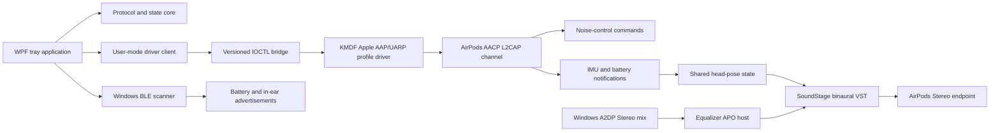

  

<h1 align="center">SoundStage for AirPods</h1>

  AirPods controls, battery telemetry, and head-tracked spatial audio for
  Windows 10 and Windows 11.

  
  
  

> [!WARNING]
> SoundStage is experimental. Its current kernel driver is locally test-signed,
> so the downloadable build requires Windows Test Mode and Secure Boot to be
> disabled. This reduces platform security and is not equivalent to a
> Microsoft production-signed driver. Read the
> [installation guide](docs/INSTALL.md) before installing it.

SoundStage is an independent open-source control center for Apple AirPods. It
recreates the controls normally available on Apple platforms while preserving
the Windows A2DP Stereo path for high-quality playback.

## Features

| Area | What SoundStage provides |
| --- | --- |
| Noise control | Off, ANC, Transparency, and Adaptive modes through Apple AAP |
| Spatial audio | System-wide `Fixed` binaural rendering and `Head Tracked` rendering |
| Motion | AirPods IMU streaming, neutral-position calibration, adaptive smoothing, and stale-sensor fallback |
| Battery | Left, right, and case levels plus charging state when advertised |
| Status | AirPods model, connection state, in-ear state, and active audio profile |
| Windows integration | Animated tray panel, single-instance behavior, autostart, desktop/Start menu shortcuts |
| Audio guidance | Detects and explains the A2DP-versus-Hands-Free microphone limitation |
| Recovery | Automatic AAP/UARP profile repair plus reversible driver, audio-effect, certificate, shortcut, and Test Mode uninstall |
| Diagnostics | One-click ZIP with Windows, Bluetooth, audio-route, driver, BCD, installer, and app state |

The interface is English so one build can be used internationally.

## Quick install

1. Download the single `SoundStage-Setup.exe` from the latest GitHub release.
2. Pair the AirPods in Windows and connect them.
3. Disable Secure Boot in UEFI/BIOS.
4. Run `SoundStage-Setup.exe` and approve the administrator prompt.
5. Restart Windows when the installer requests it.
6. Run the same `SoundStage-Setup.exe` again after Windows starts.
7. Select `AirPods Stereo` as the output device and open SoundStage from its tray
   icon.

The executable contains the application, driver, spatial engine, recovery
scripts, licenses, and checksums. Detailed preparation, verification,
troubleshooting, and uninstall steps are in
[docs/INSTALL.md](docs/INSTALL.md).

## Controls

### Noise Control

- **Off** disables active processing in the earbuds.
- **ANC** enables active noise cancellation.
- **Transparency** mixes the outside microphones into playback.
- **Adaptive** lets supported AirPods adjust noise control dynamically.

These commands are sent to the earbuds over the Apple Accessory Protocol
(AAP). They do not alter the Bluetooth adapter or Windows audio driver.

### Spatial Audio

- **Off** is bit-exact pass-through inside the SoundStage DSP.
- **Fixed** renders the Windows stereo mix as a detached pair of virtual
  loudspeakers in a compact, acoustically treated room.
- **Head Tracked** uses the same room and HRTF renderer, then rotates the
  virtual stage from live AirPods motion.

The renderer uses interaural level and time differences, far-ear filtering,
dense early reflections, and a damped feedback-delay room. Head movement is
center-calibrated and adaptively smoothed: small sensor jitter is suppressed,
while deliberate turns respond faster. Windows Sonic is disabled while
SoundStage spatialization is active to avoid double processing.

SoundStage does not import Apple's personalized ear scan or proprietary HRTF.
The current room and tracking model is an independent implementation tuned on
AirPods 4 (ANC).

### Battery and connection telemetry

SoundStage listens for Apple Bluetooth LE manufacturer advertisements and AAP
notifications. It decodes model, left/right/case battery, charging state,
in-ear flags, and connection state. Active BLE scanning automatically falls
back to passive scanning when an adapter or vendor filter rejects active mode.
Case battery is shown only when the AirPods advertise a valid case value; the
most recent valid value is retained when a transient packet reports an
unavailable placeholder.

Connection status comes from the classic paired-device state, not from a
randomized BLE address. If Windows drops the Apple control-profile device after
a reconnect, SoundStage can refresh the paired AAP/UARP services and wait for
the driver interface to return. The **Repair** button runs this explicitly;
**Report** creates a diagnostic ZIP under `Documents\SoundStage\Reports`.

## Architecture

The driver binds to Apple's AAP profile UUID
`74ec2172-0bad-4d01-8f77-997b2be0722a` and, as a reconnect fallback, the Apple
UARP service UUID `4715650b-5e9d-4ac2-b898-a4fc0aa5df78`. Either profile PDO
provides the same bounded path to the known AACP PSM. It deliberately does not
replace the Bluetooth adapter, Microsoft enumerators, A2DP audio, Hands-Free,
AVRCP, or unrelated Bluetooth services.

For component boundaries, transport details, DSP behavior, and recovery
design, see [docs/ARCHITECTURE.md](docs/ARCHITECTURE.md).

## Compatibility

- x64 Windows 10 build 19041 or newer, including Windows 10 22H2.
- x64 Windows 11.
- Bluetooth hardware supported by the Windows Bluetooth stack.
- AirPods generations exposing the Apple AAP profile, including known product
  IDs for AirPods, AirPods Pro, and AirPods Max.

The current build was validated on Windows 10 22H2 build 19045 with AirPods 4
(ANC) and a TP-Link Bluetooth 5.4 USB adapter. Compatibility diagnostics and
the lost-profile recovery path were also developed from a Windows 11 26H1
system using a BARROT Bluetooth 5.4 adapter. Other combinations still need
community testing.

## Discord, games, and microphone quality

Classic Bluetooth cannot carry high-quality A2DP stereo output and the AirPods
Hands-Free microphone simultaneously. Selecting the AirPods microphone makes
Windows switch to the low-bandwidth Hands-Free profile, which also degrades
game or music output.

For good Discord/game audio:

- output: `AirPods Stereo`;
- input: a separate USB, webcam, laptop, or audio-interface microphone.

This is a Bluetooth profile limitation, not something an AAP control driver can
remove.

## Privacy and security

- No account, cloud service, analytics, or telemetry.
- Bluetooth and audio processing stay on the local computer.
- Head-pose state is stored locally in
  `C:\ProgramData\SoundStage\head-tracking-state.bin`.
- The installer records reversible state and logs in
  `C:\ProgramData\SoundStage`.
- Diagnostic ZIPs are created only on demand and never uploaded automatically.
- The driver exposes a narrow, versioned packet bridge rather than arbitrary
  kernel memory or device access.

The test-signed driver remains the largest security tradeoff. A future public
release should use Microsoft attestation/production signing so Test Mode and
the Secure Boot change are unnecessary.

## Build and contribute

Build instructions, required toolchains, test commands, and packaging details
are in [docs/DEVELOPMENT.md](docs/DEVELOPMENT.md). Contributions are welcome;
read [CONTRIBUTING.md](CONTRIBUTING.md) before opening a pull request.

Project layout:

- `src/SoundStage.App` — WPF tray application;
- `src/SoundStage.Core` — AAP packets, parsers, and state models;
- `src/SoundStage.Platform.Windows` — BLE, Windows audio, and driver client;
- `src/SoundStage.Diagnostics` — one-click and command-line support reports;
- `driver/SoundStageKmdf` — KMDF Apple AAP/UARP profile driver;
- `audio/SoundStageSpatializer` — real-time binaural VST processor;
- `tests/SoundStage.Core.SmokeTests` — protocol and parser smoke tests;
- `installer` — reproducible single-EXE, two-stage Windows installer;
- `assets` — reproducible logo and icon generation.

## Known limitations

- The driver is test-signed, not production-signed.
- The app and driver are currently x64 only.
- Personalized Spatial Audio profiles from Apple devices are unavailable.
- ASIO and WASAPI exclusive-mode streams can bypass system audio effects.
- Battery availability depends on packets currently advertised by the
  AirPods.
- Automatic AAP/UARP repair cannot fix a disabled radio, a vendor driver that
  does not expose Apple SDP services, or severe radio interference.

## License and credits

SoundStage is licensed under
[GPL-3.0-or-later](LICENSE). Protocol work is based on the GPL LibrePods
ecosystem. Equalizer APO, SoundVolumeView, and every bundled third-party
component are documented in [THIRD_PARTY.md](THIRD_PARTY.md).

Designed and developed by **OpenAI Codex**.

AirPods, Apple, macOS, and related marks belong to Apple Inc. SoundStage is not
affiliated with or endorsed by Apple.
