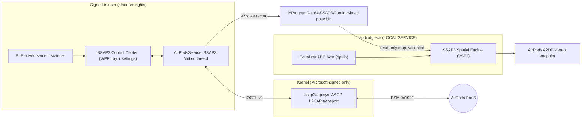

# SSAP3 architecture

## Components

| Component | Responsibility |
| --- | --- |
| `SSAP3.Core` | Pure logic, no I/O: AACP framing and parsers, listening-mode acknowledgement, quaternion math, `HeadPoseEstimator`, `MotionStreamMonitor`, `ControlChannelSupervisor`, `DeviceStatus`, conversation switching and VAD, shared-state layout, redaction |
| `SSAP3.Platform.Windows` | Windows I/O: driver client, BLE scanner, radio state, paired-device lookup, product-ID lookup, monotonic clock, high-resolution waiter, state writer, Windows Sonic control |
| `SSAP3.App` | Tray panel, settings window, and `AirPodsService` (orchestration on a dedicated thread) |
| `SSAP3.Diagnostics` | Local, redacted support bundles |
| `driver/Ssap3Aap` | KMDF profile driver on the Apple AAP service PDO: five bounded IOCTLs, bounded waits, session caps, outbound allowlist, kernel receive timestamps |
| `audio/SSAP3Spatializer` | Real-time binaural renderer |
| `installer` | Manifest-driven install, rollback and uninstall; integrity verifier |

## Motion pipeline

1. The driver queues each inbound AACP packet with `KeQueryInterruptTime()`.
2. The motion thread polls every 5 ms while tracking, using a
   high-resolution waitable timer, and converts the kernel timestamp into
   the same clock (`QueryInterruptTime`). It records driver-to-app latency
   (median and p95) for diagnostics.
3. `HeadTrackingFrameParser` strictly validates the frame. An
   `IOrientationDecoder` turns the opaque fields into a unit quaternion. The
   only decoder today is LibrePods' heuristic, **marked unverified**, with
   per-axis invert options.
4. `HeadPoseEstimator`:
   - averages the first samples into the "forward" reference (recenter);
   - smooths with a timestamp-aware One-Euro filter applied through SLERP;
   - rejects physically implausible jumps (more than 1500°/s), accepting
     them only if they persist;
   - treats gaps longer than 300 ms as a re-acquisition, blended over
     300 ms;
   - holds the last pose after 250 ms without data, then eases back to
     centre after 1.5 s;
   - optionally corrects slow drift of small, steady yaw offsets.
5. The service writes the v2 state record every 10 ms.

### Coordinate system

Right-handed: +X is the listener's right, +Y is forward towards the monitor,
+Z is up. Quaternions rotate head-frame vectors into the calibrated world
frame. Yaw is positive when turning **left** (about +Z), pitch is positive
when looking **up** (about +X), and roll is positive when the **right** ear
goes down (about +Y). Speaker azimuth is positive to the right. Both
`QuaternionMath` (C#) and the DSP use exactly this convention, and unit tests
check it.

## Spatial engine

- Reads the shared record with a sequence lock, and validates magic, version
  and enums, finite unit quaternions, parameter ranges, and freshness
  (`GetTickCount64`, 750 ms).
- Rotates each world-fixed virtual speaker into the head frame and convolves
  it with measured HRIRs (MIT KEMAR). The four nearest measurements are
  blended onset-aligned and resampled to the device rate with a band-limited
  kernel that also applies the sub-sample ITD. Early reflections and a
  4-line FDN room follow. Details: `docs/TECHNICAL_REPORT.md` §5.
- Filter updates crossfade within the block, and mode switches crossfade
  over 25 ms. Off is bit-exact. Non-finite input is sanitised and the output
  is limited.
- Allocation-free and lock-free in `Process()`. It flushes denormals and
  restores the host's FP state afterwards.

The HRIR table is generated offline (`tools/hrtf`) and compiled in, so the
engine parses no files. SOFA import is not implemented. If it is added, it
belongs in that offline converter, never inside `audiodg.exe` (ADR-5).

## Control path and acknowledgement

`ListeningModeController` sends `04 00 04 00 09 00 0D <mode> 00 00 00`. It
reports **Confirmed** only when the AirPods echo the same mode,
**Rejected** when they report a different mode, and **Unconfirmed** on
timeout. The UI shows the device-reported mode, never the requested one.

## Connection supervision

`ControlChannelSupervisor` is a pure, single-flight state machine:

- States: Idle, Unavailable(reason), Connecting, Ready, WaitingToRetry,
  Failed, Suspended.
- Exponential backoff with jitter (0.5 s to 30 s) and a bounded budget of 8
  attempts. After that it waits for a device, power or user event; there is
  no infinite retry loop.
- Sleep closes the session; resume restarts the episode.
- A missing or incompatible driver is a permanent `Unavailable` state, not a
  retry loop.

## Trust boundaries

See `SECURITY_AUDIT.md` §1 and `SECURITY_REPORT.md`. In summary:

- Bluetooth input is parsed only in user mode.
- The driver exposes a bounded, allowlisted relay to interactive users only.
- The DSP treats the state file as hostile.
- Elevated setup code runs only from admin-only folders and reads only an
  admin-only manifest.
